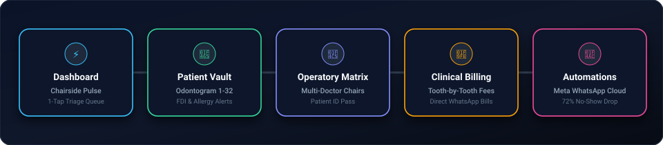
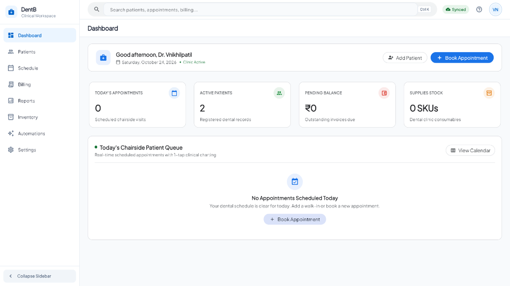
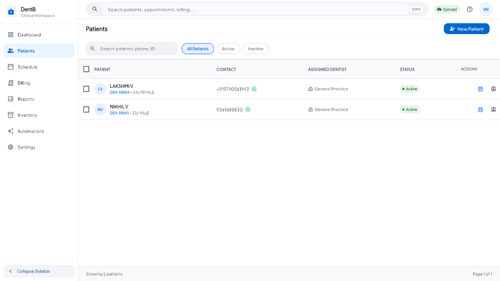
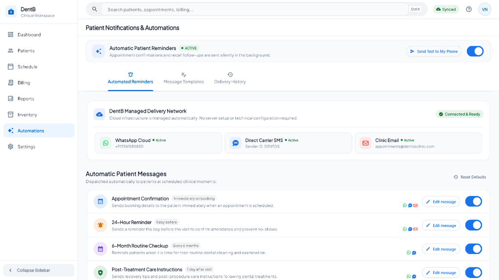

<p align="center">
  
</p>

<p align="center">
  <a href="https://github.com/VNIKHIL0/dentb-releases/releases/latest"></a>
  <a href="#-android-installation"></a>
  <a href="#-windows-installation"></a>
  
  
</p>

---

## ⚡ Direct Downloads (Production Binaries)

> [!TIP]
> Download the official standalone packages below. All packages are pre-compiled, self-contained, and cryptographically verified.

| Platform | Target Architecture | Package Type | File Size | Direct Download | Verification |
| :--- | :--- | :--- | :--- | :--- | :--- |
| **Android** | `arm64-v8a`, `armeabi-v7a`, `x86_64` | Standalone APK | **91.5 MB** | [⬇️ **Download APK (Direct)**](https://github.com/VNIKHIL0/dentb-releases/releases/download/v1.0.0/DentB-Android-v1.0.0.apk) | [SHA-256](#-package-integrity--checksums) |
| **Windows** | `x86_64` (64-bit Windows 10/11) | Portable ZIP (`.exe`) | **30.1 MB** | [⬇️ **Download ZIP (Direct)**](https://github.com/VNIKHIL0/dentb-releases/releases/download/v1.0.0/DentB-Windows-x64.zip) | [SHA-256](#-package-integrity--checksums) |

👉 **View Full Changelog & Assets:** [**GitHub Release v1.0.0 Hub**](https://github.com/VNIKHIL0/dentb-releases/releases/tag/v1.0.0)

---

## 🏗️ 5 Unified Clinical Engines

DentB orchestrates your entire dental practice across desktop operatories and mobile chairside tablets in real time:

<p align="center">
  
</p>

### 1. Clinical Dashboard
* **Real-time chairside pulse:** Instant visibility into arriving, in-chair, and completed patient triage.
* **Practice KPIs:** Live census of active patients, revenue collections, and inventory depletion warnings.

<p align="center">
  
</p>

### 2. Digital Patient Vault
* **32-Tooth Restorative Odontogram:** Universal (1–32) & FDI 2-digit systems with pediatric primary dentition support.
* **Zero Paperwork:** Instant patient allergy alerts, systemic medical history, and cryptographic privacy compliance.

<p align="center">
  
</p>

### 3. Operatory Matrix & Scheduler
* **Conflict-Free Scheduling:** Visual multi-chair grid for associate dentists and visiting specialists.
* **1-Tap Patient ID Pass:** Inspect allergies, procedure history, and insurance eligibility directly on the chair block.

<p align="center">
  
</p>

### 4. Transparent Clinical Billing
* **Itemized Dental Invoicing:** Pre-configured ADA/CDT tooth-by-tooth procedure fee codes.
* **Direct WhatsApp Invoicing:** Send branded digital payment receipts directly to patient smartphones with 1 tap.

<p align="center">
  
</p>

### 5. Meta WhatsApp Cloud Automations
* **72% No-Show Reduction:** Automated 24h appointment confirmations, pre-op instructions, and 6-month hygiene recalls.
* **Background Cloud Dispatch:** Dispatches messages silently through official Meta APIs without front-desk manual effort.

<p align="center">
  
</p>

---

## 📲 Installation Guide

### 🤖 Android Installation
1. Download **[`DentB-Android-v1.0.0.apk`](https://github.com/VNIKHIL0/dentb-releases/releases/download/v1.0.0/DentB-Android-v1.0.0.apk)** directly onto your Android device or clinical tablet.
2. Tap the downloaded `.apk` in your notification bar or **Files / Downloads** folder.
3. If prompted by Android, select **Settings** &rarr; toggle on **Allow from this source** (standard for sideloaded enterprise apps).
4. Tap **Install** &rarr; **Open** to launch DentB!

### 💻 Windows Installation
1. Download **[`DentB-Windows-x64.zip`](https://github.com/VNIKHIL0/dentb-releases/releases/download/v1.0.0/DentB-Windows-x64.zip)** onto your workstation.
2. Right-click the `.zip` file and select **Extract All...** to a location of your choice (e.g. `C:\Program Files\DentB` or `Desktop\DentB`).
3. Open the extracted folder and double-click **`DentB.exe`**.
4. *(Optional)* Right-click `DentB.exe` &rarr; **Pin to taskbar** or **Send to &rarr; Desktop (create shortcut)** for 1-click operatory access.

---

## 🔒 Package Integrity & Checksums

You can verify the cryptographic integrity of downloaded packages using SHA-256:

```bash
# PowerShell verification
Get-FileHash -Path .\DentB-Android-v1.0.0.apk -Algorithm SHA256
Get-FileHash -Path .\DentB-Windows-x64.zip -Algorithm SHA256
```

| File Name | SHA-256 Checksum |
| :--- | :--- |
| `DentB-Android-v1.0.0.apk` | `2C442D4CE75B531084740E8B274BAEA4898AEA2EEC9D469FC5A5167909BE4F34` |
| `DentB-Windows-x64.zip` | `F8DF7C158BF2F3F66064559EC5EEDD0E1C05694415D6B0CBFA708FE4B5E32D28` |

---

## 🖥️ System Requirements

| Specification | Windows Desktop | Android Tablet / Phone |
| :--- | :--- | :--- |
| **Operating System** | Windows 10 (64-bit) or Windows 11 | Android 8.0 (Oreo) or later |
| **Memory (RAM)** | 4 GB minimum (8 GB recommended) | 3 GB minimum (4 GB+ recommended) |
| **Storage** | 500 MB free disk space | 200 MB free internal storage |
| **Display** | 1280 &times; 720 minimum (1080p recommended) | 720 &times; 1280 or 10"+ Clinical Tablet |
| **Connectivity** | Online sync or 100% Offline SQLite mode | Wi-Fi / LTE for cloud synchrony |

---

## 🌐 Official Channels & Support

* 🌍 **Website & Documentation:** [dentb-landingpage.vnikhilpatil.workers.dev](https://dentb-landingpage.vnikhilpatil.workers.dev)
* 🐛 **Issue Tracker & Bug Reports:** [GitHub Issues](https://github.com/VNIKHIL0/dentb-releases/issues)
* ✉️ **Clinical Inquiries:** `support@dentbclinic.com`

---

<p align="center">
  <sub>&copy; 2026 DentB Inc. All rights reserved. The source code of DentB is proprietary and confidential.</sub>
</p>
