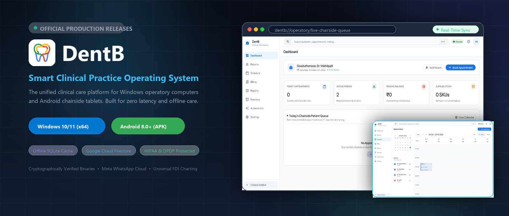
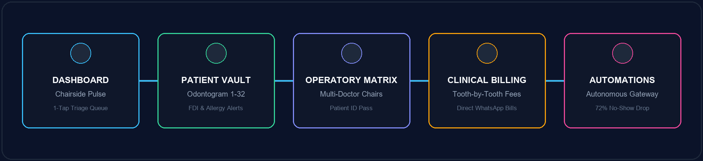
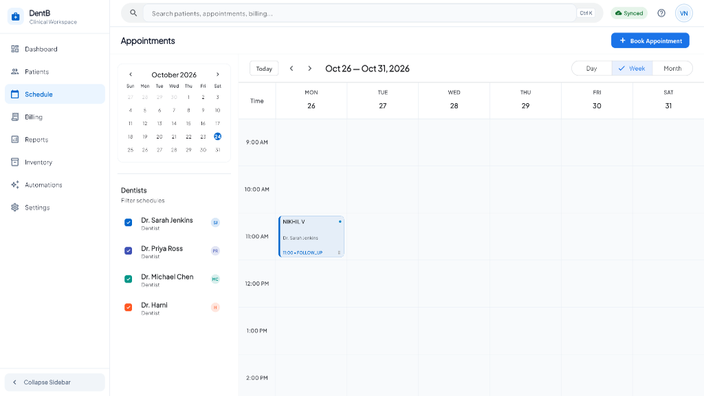
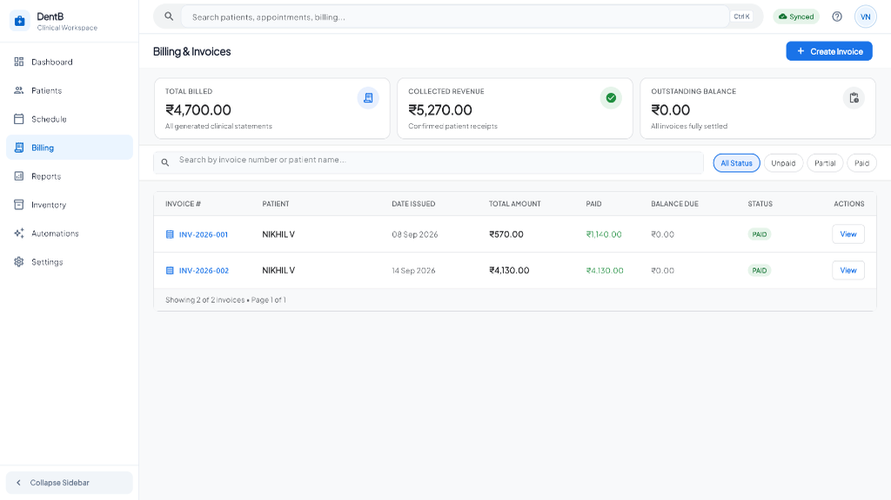

<p align="center">
  <a href="https://dentb-landingpage.vnikhilpatil.workers.dev" target="_blank" rel="noopener noreferrer">
    
  </a>
</p>

<p align="center">
  <a href="https://github.com/VNIKHIL0/dentb-releases/releases/latest"></a>
  <a href="#-android-installation"></a>
  <a href="#-windows-installation"></a>
  
  
</p>

<p align="center">
  <a href="https://github.com/VNIKHIL0/dentb-releases/releases/download/v1.1.2/DentB-Android-v1.1.2.apk">
    
  </a>
  &nbsp;&nbsp;
  <a href="https://github.com/VNIKHIL0/dentb-releases/releases/download/v1.1.2/DentB-Windows-x64.zip">
    
  </a>
  &nbsp;&nbsp;
  <a href="https://dentb-landingpage.vnikhilpatil.workers.dev" target="_blank" rel="noopener noreferrer">
    
  </a>
</p>

---

## ⚡ Direct Downloads (Production Packages)

> [!TIP]
> Download the official standalone packages below. All packages are pre-compiled, self-contained, and cryptographically verified. No compilation or dependencies required.

| Platform | Target Architecture | Package Type | Package Size | 1-Click Direct Download | Security Check |
| :--- | :--- | :--- | :--- | :--- | :--- |
| **Android** | `arm64-v8a`, `armeabi-v7a`, `x86_64` | Standalone `.apk` | **92.4 MB** | [⬇️ **Download APK (Direct)**](https://github.com/VNIKHIL0/dentb-releases/releases/download/v1.1.2/DentB-Android-v1.1.2.apk) | [Verified SHA-256](#-package-integrity--checksums) |
| **Windows** | `x86_64` (64-bit Windows 10/11) | Portable `.zip` (`DentB.exe`) | **28.7 MB** | [⬇️ **Download ZIP (Direct)**](https://github.com/VNIKHIL0/dentb-releases/releases/download/v1.1.2/DentB-Windows-x64.zip) | [Verified SHA-256](#-package-integrity--checksums) |

👉 **Release Hub on GitHub:** [**DentB Production Release v1.1.2**](https://github.com/VNIKHIL0/dentb-releases/releases/tag/v1.1.2)

---

## 🏗️ 5 Synchronized Practice Engines

DentB orchestrates your entire dental practice across desktop operatory computers and chairside tablets in real time:

<p align="center">
  
</p>

### 📸 Product Interface Showcase

<table>
  <tr>
    <th width="50%" align="center">
      <b>⚡ 1. Clinical Dashboard &amp; Chairside Queue</b><br>
      <sub>Real-time census, active patient arrivals, and revenue KPIs</sub>
    </th>
    <th width="50%" align="center">
      <b>👥 2. Digital Patient Vault &amp; Charting</b><br>
      <sub>32-tooth odontogram, FDI numbering, and medical alerts</sub>
    </th>
  </tr>
  <tr>
    <td>
      <a href="assets/DentB_app_dashboard.png" target="_blank">
        
      </a>
    </td>
    <td>
      <a href="assets/DentB_app_patients.png" target="_blank">
        
      </a>
    </td>
  </tr>
  <tr>
    <th width="50%" align="center">
      <b>📅 3. Operatory Matrix &amp; Scheduling</b><br>
      <sub>Conflict-free multi-doctor grid &amp; 1-tap Patient ID Pass</sub>
    </th>
    <th width="50%" align="center">
      <b>💬 4. Meta WhatsApp Cloud Automations</b><br>
      <sub>Automated 24h reminders &amp; 6-month hygiene recall sequences</sub>
    </th>
  </tr>
  <tr>
    <td>
      <a href="assets/DentB_app_schedule.png" target="_blank">
        
      </a>
    </td>
    <td>
      <a href="assets/DentB_app_automations.png" target="_blank">
        
      </a>
    </td>
  </tr>
  <tr>
    <th colspan="2" align="center">
      <b>🧾 5. Transparent Clinical Invoicing &amp; Instant WhatsApp Billing</b><br>
      <sub>Tooth-by-tooth ADA/CDT fee codes, digital ledger accounting, and 1-tap WhatsApp receipt dispatch</sub>
    </th>
  </tr>
  <tr>
    <td colspan="2" align="center">
      <a href="assets/DentB_app_billing.png" target="_blank">
        
      </a>
    </td>
  </tr>
</table>

---

## 📊 Cross-Platform Capability Matrix

| Clinical Capability | Windows Desktop Operatory | Android Chairside Tablet / Phone | Cloud Synchrony |
| :--- | :---: | :---: | :---: |
| **Interactive 32-Tooth Odontogram** | ✅ Full Interactive | ✅ Touch-Optimized | Real-time (&lt;50ms) |
| **Pediatric Primary Dentition (51–85)** | ✅ Supported | ✅ Supported | Real-time (&lt;50ms) |
| **6-Point Periodontal Matrix** | ✅ Advanced Grid | ✅ Visual View | Real-time (&lt;50ms) |
| **Offline-First Local SQLite** | ✅ Full Local DB | ✅ Full Local DB | Auto-Sync on Reconnect |
| **Meta WhatsApp Cloud Dispatch** | ✅ 1-Tap Trigger | ✅ 1-Tap Trigger | Cloud Webhook |
| **Self Check-In Kiosk Mode** | ✅ Full Screen | ✅ Dedicated Tablet Kiosk | Instant Reception Push |
| **Tooth-by-Tooth Invoicing** | ✅ Print &amp; WhatsApp | ✅ Digital WhatsApp Pass | Encrypted Ledger |

---

## 📲 Quick Installation Guides

<details>
<summary><b>🤖 Android Installation (Click to expand)</b></summary>

<br>

1. **Download APK:** Tap **[Download APK](https://github.com/VNIKHIL0/dentb-releases/releases/download/v1.1.0/DentB-Android-v1.1.0.apk)** directly on your Android phone or clinical tablet.
2. **Open Downloads:** Open your browser's **Downloads** or notification drawer and tap **`DentB-Android-v1.1.0.apk`**.
3. **Allow Installation:** If prompted by Android Security, tap **Settings** &rarr; toggle on **Allow from this source**.
4. **Complete Setup:** Tap **Install** &rarr; **Open** to launch DentB!
</details>

<details>
<summary><b>💻 Windows Installation (Click to expand)</b></summary>

<br>

1. **Download Archive:** Click **[Download ZIP](https://github.com/VNIKHIL0/dentb-releases/releases/download/v1.1.0/DentB-Windows-x64.zip)** on your Windows PC.
2. **Extract Files:** Right-click **`DentB-Windows-x64.zip`** &rarr; select **Extract All...** to your desired folder (e.g., `C:\DentB` or `Desktop\DentB`).
3. **Launch Application:** Double-click **`DentB.exe`** inside the extracted folder.
4. *(Optional)* Right-click `DentB.exe` &rarr; **Pin to Taskbar** for instant 1-click chairside access.
</details>

---

## 🔒 Package Integrity & Checksums

<details>
<summary><b>🛡️ Cryptographic SHA-256 Checksums (Click to expand)</b></summary>

<br>

Verify that your downloaded binary has not been tampered with:

```powershell
# PowerShell verification on Windows
Get-FileHash -Path .\DentB-Android-v1.1.0.apk -Algorithm SHA256
Get-FileHash -Path .\DentB-Windows-x64.zip -Algorithm SHA256
```

```bash
# Linux / macOS / Android Terminal
sha256sum DentB-Android-v1.1.1.apk
sha256sum DentB-Windows-x64.zip
```

| Package | SHA-256 Checksum |
| :--- | :--- |
| **`DentB-Android-v1.1.1.apk`** | `201241030C4B83EF8CDCAA77E48C99AA09770C99A1696EFD6776644942011F53` |
| **`DentB-Windows-x64.zip`** | `A69E754709853C05D66CEF09119BC8EB3F6FC79642BBDF60F340A1C8EAC586FF` |

</details>

---

## 🖥️ System Requirements

| Specification | Windows PC Workstation | Android Tablet / Smartphone |
| :--- | :--- | :--- |
| **Operating System** | Windows 10 (64-bit) or Windows 11 | Android 8.0 (Oreo) or later |
| **Processor** | Intel Core i3 / AMD Ryzen 3 or higher | 64-bit Octa-Core (Snapdragon, MediaTek, Exynos) |
| **Memory (RAM)** | 4 GB minimum (8 GB recommended) | 3 GB minimum (4 GB+ recommended) |
| **Storage** | 500 MB free space | 200 MB free storage |
| **Display** | 1280 &times; 720 (1080p recommended) | 720 &times; 1280 or 10"+ Clinical Tablet |
| **Network** | Offline-First (Optional Cloud Sync) | Offline-First (Optional Wi-Fi / LTE Sync) |

---

## 🌐 Official Channels & Support

* 🌍 **Live Website:** [dentb-landingpage.vnikhilpatil.workers.dev](https://dentb-landingpage.vnikhilpatil.workers.dev)
* 🐛 **Bug Reports & Feature Requests:** [GitHub Issues](https://github.com/VNIKHIL0/dentb-releases/issues)
* ✉️ **Clinical Operations:** `support@dentbclinic.com`

---

<p align="center">
  <sub>&copy; 2026 DentB Inc. All rights reserved. The source code of DentB is proprietary and confidential.</sub>
</p>
